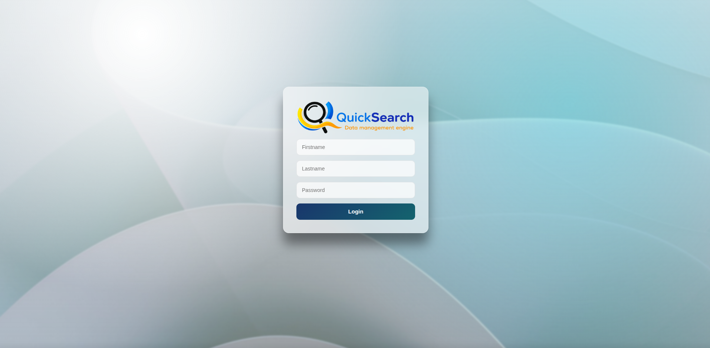
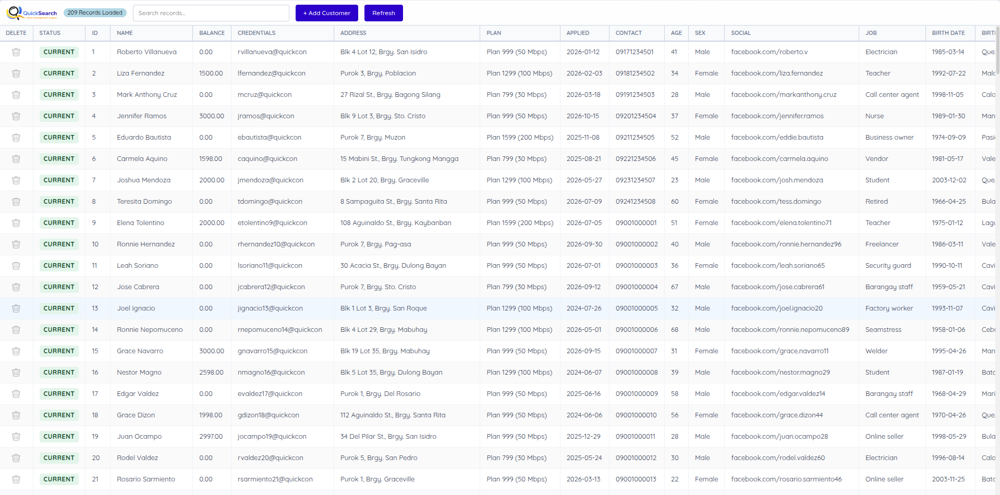
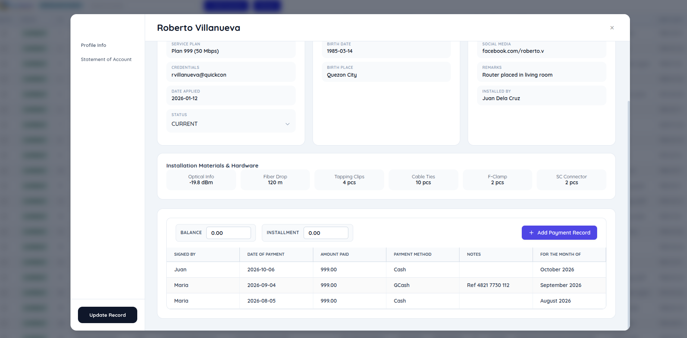
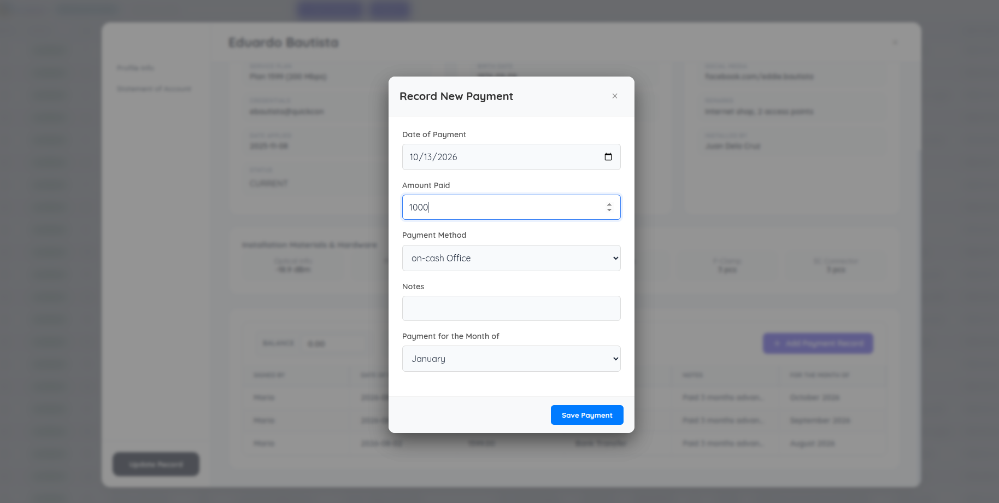
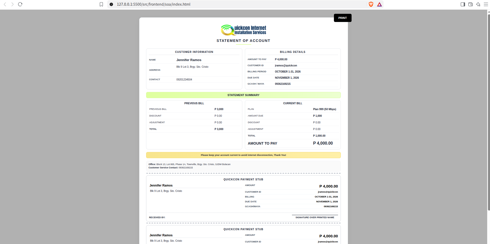
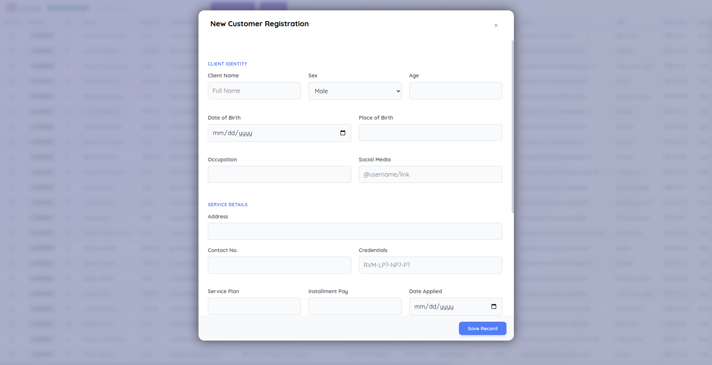

# QuickSearch Billing Management System
**A full-stack billing system for Quickcon Internet Installation Services**

---

## At a Glance
| Item | Details |
|---|---|
| **Role** | Sole developer (backend, DB, frontend, deployment) |
| **Duration** | ~3 months |
| **Used by** | Quickcon staff (daily bill payment processing) |
| **Stack** | C++ (custom backend), MariaDB, vanilla HTML/CSS/JavaScript |

---

## The Problem
Quickcon handled **1,400 internet subscribers** using **Google Sheets** with only **3 staff**.

That made daily work slow and error-prone:
- searching customers
- confirming who paid
- generating bills via manual Word templates

---

## My Solution
I built a web app that centralizes the billing workflow:
- staff search customers instantly
- record payments
- review payment history
- generate & print bills automatically from stored customer data

> Bills remain editable so staff can handle exceptions without breaking the workflow.

---

## Key Features 
- **Instant customer search** across hundreds of records
- **Payment status tracking**: `paid`, `pending`, `overdue`
- **Full payment history** per customer account
- **Automatic bill generation + printing** from customer records
- **Staff authentication**: hashed passwords + token-based sessions

---

> **Presentation-only:** All customer data and figures shown in the screenshots are fictional and for demonstration purposes only.

## Screenshots 

| | |
|---|---|
|  |  |
| <b>Staff login</b> | <b>Customer list</b> |
|  |  |
| <b>Customer info</b> | <b>Payment processing</b> |
|  |  |
| <b>Bill generator</b> | <b>Add customer</b> |

---

## Technical Highlights
### Custom C++ Backend 
- Implemented request handling, authentication, and DB access in C++
- Code split into modules for accounts, tokens, and database access

### Secure Authentication
- Password hashing with **libsodium**
- Sessions via **JWT tokens**

### Security Testing
- Used **Burp Suite** focusing on authentication + authorization

### Data Model
- **MariaDB relational tables** for:
  - users
  - customer records
  - payment history
- Access via **MariaDB Connector/C++**

### Frontend Approach
- **No frameworks** (plain HTML/CSS/JS) for speed and simplicity for non-technical staff

### Debugging & Reliability
- Used **Wireshark** to inspect and debug client-server traffic during development

---

## Challenges & What I Learned
Use this section as your “interview gold”:
- **Concurrency & data safety**: i've learned how to prevent simultaneous staff actions from corrupting data (mutex-based approach)
- **Fast bill generation & printing**: Built a browser template that staff can you use to directly print from it
- **Architecture Design** I've learned designing and building a REST archiceture web application
- **Authentication and Authorization**: I've learned to use JWT for security

---

## Impact

- Reduced billing time per customer
- Fewer payment mistakes / fewer manual steps
- Faster bill generation & printing
- Faster data review and payment history checking

---
